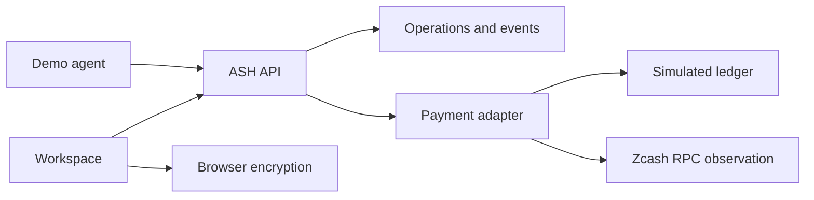

# ASH

ASH is an open-source workspace for private financial operations. People and agents use the same operation model to prepare a shielded Zcash payment, deliver an encrypted file, renew access, or export a limited evidence package.

ASH is not a wallet, a marketplace, or a general file store. It coordinates the operation and keeps the spending authority in a wallet ASH does not hold.

## Problem

A shielded payment still leaks information through memos, invoices, subscriber lists, and full wallet exports. A payment and a file are also not an atomic trade. Teams end up sharing a viewing key, a spreadsheet of recipients, or a screenshot of a transaction id.

## What ASH does

One operation moves through create, conditions, authorization, payment, verification, delivery or access, reconciliation, and evidence. A tip stops after a receipt. A data exchange can continue into recovery.

| Module | Status | What you can do now |
| --- | --- | --- |
| Shielded payroll | Implemented with a simulated adapter | Validate a batch, authorize, execute, retry a failed line, and export an aggregate report |
| Tip jar and receipts | Implemented | ZIP-321 request, simulated or observed payment, signed amount receipt |
| x402-style API payments | Implemented as an ASH extension | HTTP 402 challenge, one-time fulfillment, TypeScript SDK, demo agent |
| Encrypted exchange | Implemented as a labeled prototype | Client-side AES-GCM, Shamir 2-of-3 delivery, local decrypt |
| Audit grants | Partially implemented | Honest scope records and filtered reports. Viewing keys are not stored or revoked |
| Subscriptions | Implemented as renewal coordination | Explicit renewals, grace, soft restriction, cancellation |
| Memo linter | Implemented | Local pattern analysis and a reviewed cleanup |
| Dispute evidence | Implemented | Signed package, optional encryption to an arbiter key, local verification |

Payment states are separate: instructions created, submitted, observed, verified, confirmed, rejected, unresolved. Only a simulated payment marked `verified`, or a chain payment marked `confirmed` with enough confirmations, can satisfy a release. This build's chain adapter never marks a payment confirmed. It only reports that a node saw a transaction id.

## Architecture

Next.js App Router serves the workspace and the API. Domain services share one operation record, one append-only event log, and one payment adapter. PostgreSQL is used when `DATABASE_URL` is set. Local development uses a JSON file. Tests use memory.



Details are in [docs/ARCHITECTURE.md](docs/ARCHITECTURE.md).

## Stack

- Next.js 15 App Router, React 19, TypeScript
- Zod for request schemas
- `@noble/ciphers`, `@noble/curves`, and `@noble/hashes`
- Self-hosted Newsreader, Outfit, and IBM Plex Mono
- `postgres` when a database URL is configured
- Vitest

Amounts are integer zatoshi. One ZEC is 100,000,000 zatoshi. Floating-point values are not the source of truth.

## Local setup

```bash
cd ash
pnpm install
cp .env.example .env.local
pnpm dev
```

Open http://127.0.0.1:3000 and sign in as a demo persona. There is no password. Avery Chen operates payroll and agents. Noor Hale publishes offers and tips. Jules Okonkwo buys. Sam Ibarra sees aggregate payroll reports.

```bash
pnpm test
pnpm typecheck
pnpm lint
pnpm build
pnpm agent:demo
```

`pnpm agent:demo` needs ASH already running, from `pnpm dev` or `pnpm start`. It writes `demo-output/`, which is gitignored.

## Environment

See `.env.example`.

| Variable | Purpose |
| --- | --- |
| `ASH_ZCASH_NETWORK` | `testnet` (default) or `mainnet` |
| `ASH_PAYMENT_MODE` | `simulated` (default) or `chain` |
| `ZCASH_RPC_URL` | Optional `getrawtransaction` endpoint |
| `ZCASH_RPC_USER`, `ZCASH_RPC_PASSWORD` | Optional RPC basic auth |
| `ASH_REQUIRED_CONFIRMATIONS` | Default 3. Observation alone still does not release data |
| `ASH_PAY_TO` | Shielded address on API challenges. The code default is an unfunded structural fixture |
| `SESSION_SECRET`, `RECEIPT_SIGNING_SECRET` | Required before a shared deployment |
| `DATABASE_URL` | Postgres. Required on Vercel |
| `ASH_DATA_PATH` | Local JSON store, default `.data/ash.json` |

Do not put a seed phrase, spending key, or viewing key in the environment.

## Database

`db/migrations/001_init.sql` creates `documents` and `events`. The Postgres store also applies that SQL on first use. Indexes: primary key `(kind, id)` and `events_operation_idx` on `(operation_id, created_at)`.

Retention is not automatic. The JSON and Postgres stores keep operation records until you delete the database. Encrypted payloads live in the offer document. Content keys do not.

Without `DATABASE_URL`, a normal local process uses the JSON file. On Vercel, a missing database URL returns HTTP 503 instead of writing to the function disk.

## Deployment

Production is https://ash-nu-khaki.vercel.app. The app uses Neon Postgres and the simulated testnet adapter. Setup steps and the checks that were run are in [docs/DEPLOYMENT.md](docs/DEPLOYMENT.md).

## Implementation status

**Implemented:** shared lifecycle, authorization, idempotency, event hash chain, simulated payments, client-side encryption, the eight workflows above, the reference 402 endpoint, the SDK, and the demo agent.

**Simulated:** the default payment adapter. Receipts from it say so.

**Partially implemented:** chain observation via `getrawtransaction`. It cannot see a shielded amount, recipient, or memo. Viewing-key grants are disclosures, not key custody. Conditional delivery is Shamir sharing with an explicit mediator share on the server.

**Planned:** broadcasting transactions, wallet-produced diversified addresses, FROST signing, automatic recurring shielded transfers, and a Halo 2 circuit. ASH does not claim those.

## Limitations

- ASH does not construct or broadcast Zcash transactions and does not hold spend authority.
- A ZIP-321 link is a request to a wallet. Opening it does not pay.
- Diversified addresses are not derived here. A viewing key links every diversifier of the same account. Address diversification is not a correlation defense by itself.
- An application expiry does not revoke a viewing key someone already copied.
- The Shamir prototype is not escrow, not FROST, and not an atomic swap. If the buyer never saved share 1 and both the seller and the server share are gone, the file key is gone. A refund is a new payment, not a clawback.
- The event hash chain detects accidental edits. Someone who holds the receipt signing secret can rewrite and re-sign.
- The memo linter misses sensitive text that does not match its patterns.
- The Pedersen sum proof is not a Zcash proof and does not prove that a person was paid.
- Demo personas are a convenience. They are not an authentication system for a public deployment.

## License

MIT. See [LICENSE](LICENSE).
