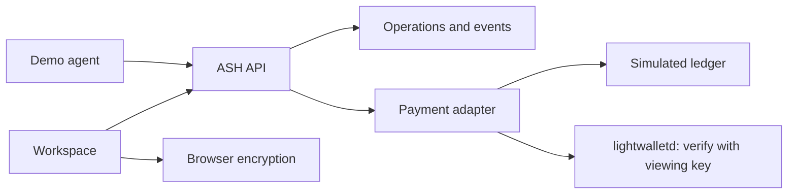

# ASH

ASH is an open-source workspace for private financial operations. People and agents use the same operation model to prepare a shielded Zcash payment, deliver an encrypted file, renew access, or export a limited evidence package.

ASH is not a wallet, a marketplace, or a general file store. It coordinates the operation and keeps the spending authority in a wallet ASH does not hold.

## Problem

A shielded payment still leaks information through memos, invoices, subscriber lists, and full wallet exports. A payment and a file are also not an atomic trade. Teams end up sharing a viewing key, a spreadsheet of recipients, or a screenshot of a transaction id.

## What ASH does

One operation moves through create, conditions, authorization, payment, verification, delivery or access, reconciliation, and evidence. A tip stops after a receipt. A data exchange can continue into recovery.

| Module | Status | What you can do now |
| --- | --- | --- |
| Shielded payroll | Implemented | Validate a batch, authorize, pay from your wallet, confirm lines on chain with your full viewing key, export an aggregate report |
| Tip jar and receipts | Implemented | ZIP-321 request with a memo reference, verified on chain in testnet and mainnet, signed receipt |
| x402-style API payments | Implemented as an ASH extension | HTTP 402 challenge, one-time fulfillment, TypeScript SDK, demo agent |
| Encrypted exchange | Implemented as a labeled prototype | Client-side AES-GCM, Shamir 2-of-3 delivery, local decrypt |
| Audit grants | Partially implemented | Honest scope records and filtered reports. Viewing keys are not stored or revoked |
| Subscriptions | Implemented as renewal coordination | Explicit renewals, grace, soft restriction, cancellation |
| Memo linter | Implemented | Local pattern analysis and a reviewed cleanup |
| Dispute evidence | Implemented | Signed package, optional encryption to an arbiter key, local verification |

Payment states are separate: instructions created, submitted, observed, verified, confirmed, rejected, unresolved. Only a practice payment marked `verified` (practice mode only), or a chain payment marked `confirmed` with enough confirmations, can satisfy a release. A chain payment is confirmed only after ASH decrypts it with the payee's viewing key and the amount, recipient, memo reference, and note commitment all match.

## Architecture

Next.js App Router serves the workspace and the API. Domain services share one operation record, one append-only event log, and one payment adapter. PostgreSQL is used when `DATABASE_URL` is set. Local development uses a JSON file. Tests use memory.

Read-only pages use a lock-free read path and resolve the demo persona without a database call, so a page costs one or two queries. The schema and persona seed run once per server process.



Details are in [docs/ARCHITECTURE.md](docs/ARCHITECTURE.md).

## Stack

- Next.js 15 App Router, React 19, TypeScript
- Zod for request schemas
- `@noble/ciphers`, `@noble/curves`, and `@noble/hashes`
- Self-hosted Outfit for the interface, and IBM Plex Mono for references
- `postgres` when a database URL is configured
- Vitest

Amounts are integer zatoshi. One ZEC is 100,000,000 zatoshi. Floating-point values are not the source of truth.

## Local setup

```bash
cd ash
pnpm install
cp .env.example .env.local
pnpm dev
```

Open http://127.0.0.1:3000 and sign in as a demo persona. There is no password. Avery Chen operates payroll and agents. Noor Hale publishes offers and tips. Jules Okonkwo buys. Sam Ibarra sees aggregate payroll reports.

```bash
pnpm test
pnpm typecheck
pnpm lint
pnpm build
pnpm agent:demo
pnpm smoke
```

`pnpm agent:demo` and `pnpm smoke` need ASH already running, from `pnpm dev` or `pnpm start`. Set `ASH_BASE_URL` to point them at another deployment. `pnpm smoke` walks every module over HTTP, reads the server's network and payment mode from `/api/ash/health`, and expects the matching behavior. `pnpm agent:demo` writes `demo-output/`, which is gitignored.

## Practice, testnet, and mainnet

Switch modes in the sidebar (or at the top of the screen on phones). Each mode is its own workspace.

| Mode | What happens |
| --- | --- |
| Practice | Labeled practice payments. Nothing is sent. Sample fixture addresses are prefilled. |
| Testnet | Real Zcash testnet payments from your wallet, verified on chain. Test coins have no value. |
| Mainnet | Real Zcash mainnet payments from your wallet, verified on chain. Real money. |

To be paid in testnet or mainnet, add your receiving address and a viewing key under **Receiving keys**. A payment request then shows a ZIP-321 link, a QR code, and a unique memo. The payer's wallet signs and broadcasts the transaction. ASH finds it through lightwalletd, decrypts it with your viewing key, checks the amount, recipient, memo reference, and note commitment, and unlocks the tip receipt, file, subscription period, or paid API once it has enough confirmations. Payroll is confirmed from the operator's outgoing notes. ASH never holds a spending key. Details: [docs/ZCASH_INTEGRATION.md](docs/ZCASH_INTEGRATION.md).

Demo personas are shared and have no password. On a public deployment, anyone can change a persona's receiving key, so do not take real mainnet payments there without real accounts.

## Environment

See `.env.example`.

| Variable | Purpose |
| --- | --- |
| `ASH_MODES` | Modes offered, default `practice,testnet,mainnet` |
| `ASH_DEFAULT_MODE` | Mode for new visitors, default `practice` |
| `VIEWING_KEY_SECRET` | Seals stored viewing keys. Required in production |
| `ASH_LIGHTWALLETD_TESTNET`, `ASH_LIGHTWALLETD_MAINNET` | lightwalletd endpoints. Defaults: testnet.zec.rocks and zec.rocks |
| `ASH_CONFIRMATIONS_TESTNET`, `ASH_CONFIRMATIONS_MAINNET` | Confirmations before a payment counts. Defaults 1 and 3 |
| `SESSION_SECRET`, `RECEIPT_SIGNING_SECRET` | Required before a shared deployment |
| `DATABASE_URL` | Postgres. Required on Vercel |
| `ASH_DATA_PATH` | Local JSON store, default `.data/ash.json` |

Do not put a seed phrase or spending key anywhere. Viewing keys are added in the app and stored sealed, never in the environment.

## Database

`db/migrations/001_init.sql` creates `documents` and `events`. The Postgres store also applies that SQL on first use. Indexes: primary key `(kind, id)` and `events_operation_idx` on `(operation_id, created_at)`.

Retention is not automatic. The JSON and Postgres stores keep operation records until you delete the database. Encrypted payloads live in the offer document. Content keys do not.

Without `DATABASE_URL`, a normal local process uses the JSON file. On Vercel, a missing database URL returns HTTP 503 instead of writing to the function disk.

## Deployment

Production is https://ash-nu-khaki.vercel.app. The app uses Neon Postgres and the simulated testnet adapter. Setup steps and the checks that were run are in [docs/DEPLOYMENT.md](docs/DEPLOYMENT.md).

## Implementation status

**Implemented:** shared lifecycle, authorization, idempotency, event hash chain, simulated payments, client-side encryption, the eight workflows above, the reference 402 endpoint, the SDK, and the demo agent.

**Practice mode:** the simulated payment adapter. Receipts from it say so.

**Implemented for testnet and mainnet:** Sapling payment verification with viewing keys over lightwalletd, checked against the official zcash-test-vectors. **Partially implemented:** Orchard and Ironwood notes are not verified, so payment requests use Sapling receivers. Viewing-key grants are disclosures, not key custody. Conditional delivery is Shamir sharing with an explicit mediator share on the server.

**Planned:** Orchard and Ironwood verification, wallet-produced diversified addresses, FROST signing, automatic recurring shielded transfers, and a Halo 2 circuit. ASH does not claim those.

## Limitations

- ASH does not construct or broadcast Zcash transactions and does not hold spend authority. The payer's wallet broadcasts.
- ASH trusts its lightwalletd server to report blocks honestly. Amounts, recipients, and memos are verified cryptographically.
- A receiving key reveals every payment into that wallet account. Use a dedicated account.
- A ZIP-321 link is a request to a wallet. Opening it does not pay.
- Diversified addresses are not derived here. A viewing key links every diversifier of the same account. Address diversification is not a correlation defense by itself.
- An application expiry does not revoke a viewing key someone already copied.
- The Shamir prototype is not escrow, not FROST, and not an atomic swap. If the buyer never saved share 1 and both the seller and the server share are gone, the file key is gone. A refund is a new payment, not a clawback.
- The event hash chain detects accidental edits. Someone who holds the receipt signing secret can rewrite and re-sign.
- The memo linter misses sensitive text that does not match its patterns.
- The Pedersen sum proof is not a Zcash proof and does not prove that a person was paid.
- Demo personas are a convenience. They are not an authentication system for a public deployment.

## License

MIT. See [LICENSE](LICENSE).
