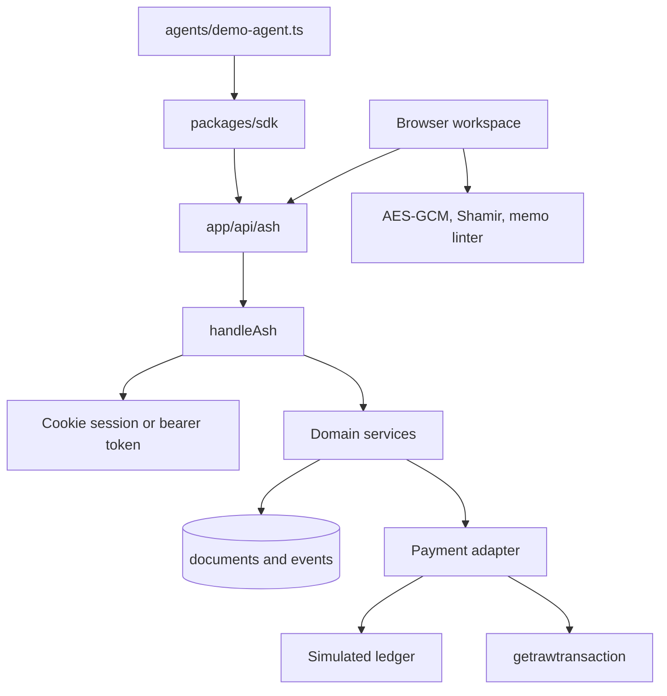
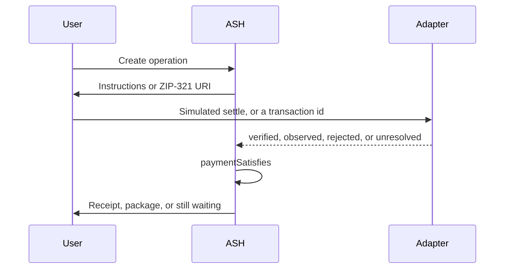

# Architecture

ASH is one Next.js application. The workspace, the JSON API, and the paid research route call the same services. Modules do not keep private copies of the payment or authorization logic.

## Request path

Server components read through the services and the store. Mutations go to `/api/ash/*` with `expectedVersion` and, for creates and payments, `Idempotency-Key`. The browser encrypts files and analyzes memos before anything is uploaded.

## Shared records

`OperationRecord` is the base: id, type, state, initiator, participants, policy version, timestamps, disclosures, an optional payment, and an optional access record. Type-specific documents live beside it: `payroll`, `tip`, `offer`, `exchange`, `grant`, `subscription`, `challenge`, `memo_check`, `evidence`.

Operation types in use are `payroll_run`, `tip`, `api_request`, `data_exchange`, `audit_grant`, `subscription`, `memo_check`, and `dispute_evidence`. Conditional delivery is a `data_exchange` whose protocol field is `shamir-2-of-3-mediator`. It is not a second stored type.

## State machine

Allowed edges are in `src/domain/machine.ts`. `saveOperation` rejects a transition that is not listed. The same state may be saved again. Examples that the machine and the services both refuse:

- Completing a payroll run while a line is not verified or cancelled.
- Releasing an encrypted package before `paymentSatisfies` is true.
- Completing an API request from the challenge state.
- Renewing a cancelled subscription.
- Marking a locally sealed evidence package as independently verified.

A failed line stays failed until a new attempt key is used. Re-executing a verified line does not create a second ledger row.

## Payment flow

`paymentSatisfies` is the only gate for release, API fulfillment, subscription extension, and payroll completion. Chain observation returns `observed` or `unresolved`. It never returns `verified` or `confirmed`.

The simulated ledger key is the idempotency key of that attempt. A repeated key returns the stored result and does not charge an agent budget twice. `failNextPayment` writes a rejected row without a charge so a later attempt can use a new key.

## Encryption path

The seller's browser calls `encryptPack` and uploads ciphertext plus the plaintext hash. The content key stays in `localStorage` and can be copied by the seller. At release, the seller splits the key into shares 1, 2, and 3, seals shares 1 and 2 to the buyer's X25519 key, and stores share 3 on the server. The buyer combines two shares locally and decrypts. The server cannot.

## Proofs and signatures

Payroll totals can carry a ristretto255 Pedersen commitment and a Schnorr proof that the openings sum to the published total. Receipts and evidence packages are Ed25519 signatures over canonical JSON. The signing seed is SHA-256 of `RECEIPT_SIGNING_SECRET`. None of these is a Zcash Halo 2 proof.

## Agents

An operator mints `ash_{prefix}_{secret}`. ASH stores only SHA-256 of the token. Scopes are `read`, `pay`, `exchange`, and `payroll`. `assertPerson` blocks agents from authorization, grant creation, offer publication, and delivery release. `chargeAgent` enforces the budget.

## Store

`MemoryStore` clones documents, seeds the four personas, and commits only if the transaction function resolves. Writes are serialized in-process and use optimistic versions. `FileStore` adds an atomic rename. `PostgresStore` uses a transaction and `SELECT FOR UPDATE`. Events are append-only at the application layer. The database owner can still edit rows.

## External dependencies

- A Zcash wallet, outside ASH, if someone pays a ZIP-321 URI.
- An optional Zcash node JSON-RPC URL for observation.
- Postgres for any multi-instance host.

No lightwalletd, no wallet SDK, and no spending keys are linked in this build.
